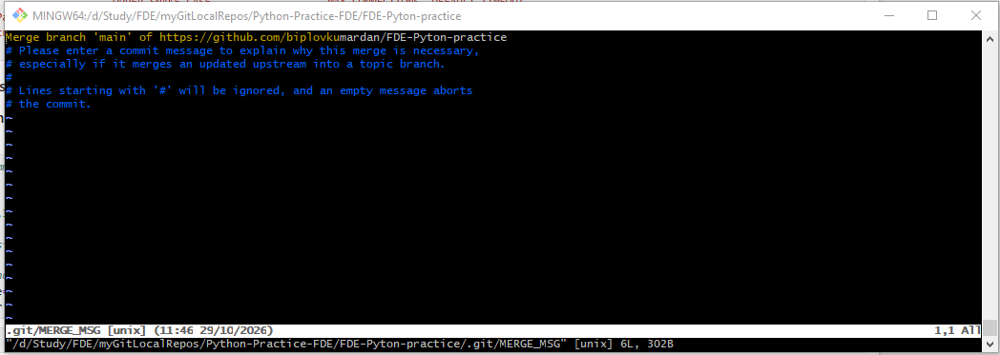
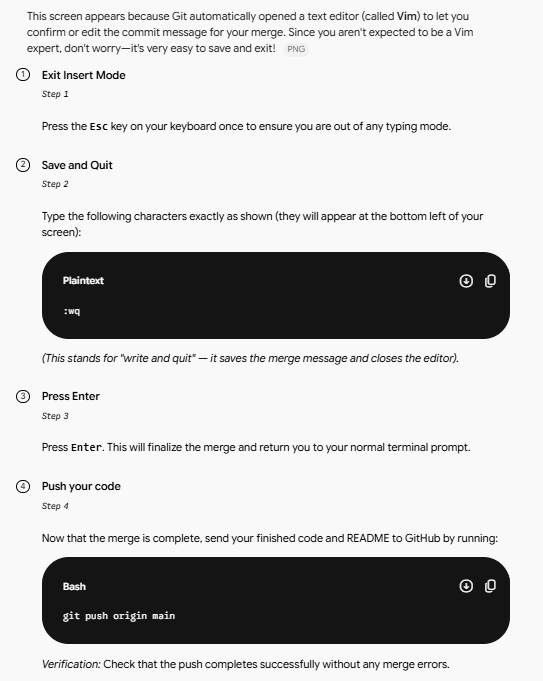
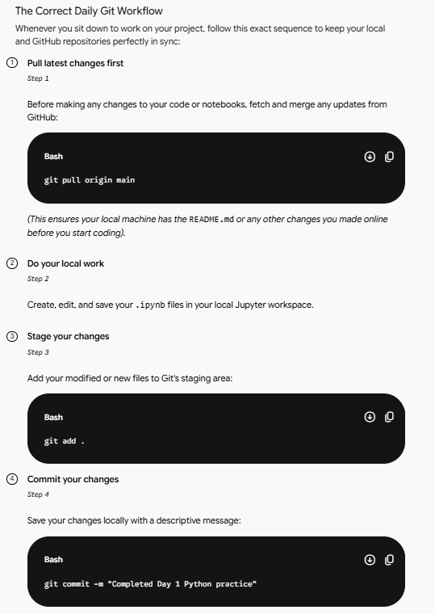
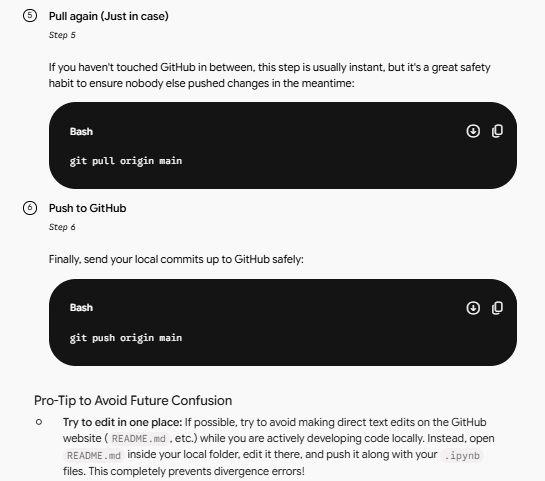

**Tutorial Path:** https://learn.nareshit.com/courses/take/new-course-1343/multimedia/79328352-session-12-27th-oct 

***Issue 1:***
**Fix jupyter notebook path issue**

***Issue 2:***
**If notebook module not found**

***Altrnative solution:***
I am using **Anaconda Prompt** to open a notebook:

(base) C:\Users\Hi>cd /d D:\Study\FDE\myGitLocalRepos\Python-Practice-FDE\FDE-Pyton-practice

(base) D:\Study\FDE\myGitLocalRepos\Python-Practice-FDE\FDE-Pyton-practice>jupyter notebook

****Git Steps: IMPORTANT****

**To Update the GitHub with updated file:**

***Issue 3:***

I think i know the reason for this merge issue. I used to update ReadMe.md file directly in GitHub. But the ipynb files, I am updating in my local working directory and try to push my ipynb files. That time this merge conflict is coming. Help me to rectify my mistake and correct steps to do the merge or pull before push in github

You hit the nail on the head! Your diagnosis is 100% correct.

When you edit files (like README.md) directly on the GitHub website, GitHub creates a brand-new commit on the remote repository. Your local laptop doesn't know about that commit yet. Meanwhile, when you work on your .ipynb files locally and try to push, Git realizes that the remote history and your local history have diverged, resulting in that merge prompt.

To avoid this headache in the future, you should follow the Golden Rule of Git: Always Pull Before You Push (and ideally, pull before you even start working).

