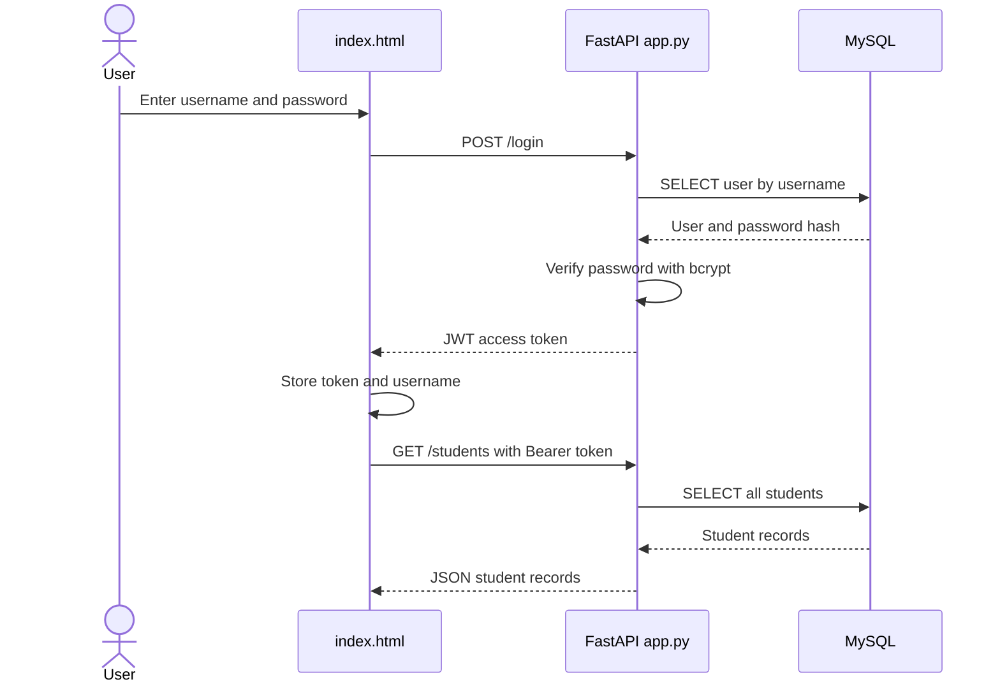

# Project Setup and Execution Guide

Follow the steps below to clone, configure, run, and test the project on your local machine.

## 1. Clone the GitHub Repository

Open VS Code terminal or Git Bash and execute:

```bash
git clone <YOUR_GITHUB_REPOSITORY_URL>
```

Navigate into the project directory:

```bash
cd <PROJECT_FOLDER_NAME>
```

## 2. Install Required Python Packages

Make sure Python is installed on your system.

Check Python version:

```bash
python --version
```

Install all the required dependencies using `requirements.txt`:

```bash
pip install -r requirements.txt
```

This will install all the Python packages required for the backend application.

## 3. Configure MySQL Credentials

Open `app.py` in VS Code.

Locate the MySQL database configuration and update the credentials according to your local MySQL setup.

Example:

```python
db_config = {
    "host": "localhost",
    "user": "root",
    "password": "root",
    "database": "dev"
}
```

Update the following details:

- **host:** localhost
- **user:** Your MySQL username
- **password:** Your MySQL password
- **database:** Your database name

Save the changes.

**Important:** Make sure your MySQL server is running.

## 4. Execute the SQL Script in MySQL Workbench

1. Open MySQL Workbench.
2. Connect to your local MySQL server.
3. Open the SQL script provided in the project.
4. Review the database and table creation queries.
5. Execute the complete SQL script by clicking the lightning icon.
6. Refresh the Schemas section.
7. Verify that the database and required tables are created successfully.

Make sure the database name in `app.py` matches the database created using the SQL script.

## 5. Install Live Server Extension in VS Code

We are using the frontend locally.

Follow these steps:

1. Open VS Code.
2. Navigate to Extensions.
3. Search for **Live Server**.
4. Install the Live Server extension.
5. Open the project folder in VS Code.

No frontend-backend IP address changes are required because we are running both applications locally.

The frontend is configured to communicate with the backend using:

```javascript
http://127.0.0.1:8000
```

## 6. Start the FastAPI Backend

Open a terminal in VS Code.

Make sure you are inside the project directory.

Start the backend application:


```bash
python app.py
```

Once the application starts successfully, the backend will be available at:

**Backend URL:**

```text
http://127.0.0.1:8000
```

**Swagger API Documentation:**

```text
http://127.0.0.1:8000/docs
```

Keep this terminal running.

## 7. Start the Frontend Using Live Server

1. Navigate to the frontend folder.
2. Locate `index.html`.
3. Right-click on `index.html`.
4. Select **Open with Live Server**.

## 8. Tech Stack

| Technology | Used in | Purpose |
|---|---|---|
| HTML5 | `index.html` | Defines the authentication form, student interface, navigation, and live socket page |
| CSS | `index.html` | Provides styling, layouts, responsiveness, animations, and dark/light component styles |
| JavaScript | `index.html` | Handles authentication, API calls, CRUD operations, UI updates, chat, and reconnection |
| Fetch API | `index.html` | Sends HTTP requests from the browser to the FastAPI backend |
| WebSocket API | `index.html` | Maintains a real-time bidirectional connection with FastAPI |
| JSON | `index.html` | Exchanges request and response data with the backend |
| `sessionStorage` | `index.html` | Stores the JWT and logged-in username in the browser session |
| FastAPI | `app.py` | Provides the REST API and WebSocket server |
| Python | `app.py` | Backend programming language |
| Pydantic | `app.py` | Defines request models and validates incoming data |
| JWT / `python-jose` | `app.py` | Creates and verifies authentication tokens |
| bcrypt | `app.py` | Securely hashes and verifies user passwords |
| MySQL | `app.py` | Stores users and student records |
| MySQL Connector/Python | `app.py` | Connects FastAPI to the MySQL database |
| CORS Middleware | `app.py` | Allows browser requests from the configured frontend origin |
| WebSocket | `app.py` | Handles real-time client-server messages |
| Uvicorn | `app.py` | Runs the FastAPI application server |

## Database Objects

The application uses the MySQL database `student_db`. The database structure shown in MySQL Workbench contains two tables:

```text
student_db
├── students
│   ├── id
│   ├── name
│   ├── age
│   └── course
└── users
    ├── id
    ├── username
    └── password
```

| Object | Type | Purpose | Used for |
|---|---|---|---|
| `student_db` | Database | Logical container for application data | Connecting the FastAPI backend to MySQL |
| `students` | Table | Stores student records | Student CRUD operations |
| `students.id` | Column | Unique identifier for a student | Finding, updating, and deleting a student |
| `students.name` | Column | Student's full name | Displaying and filtering student records |
| `students.age` | Column | Student's age | Displaying records and calculating average age |
| `students.course` | Column | Course assigned to a student | Filtering and course statistics |
| `users` | Table | Stores application login accounts | Signup and login |
| `users.id` | Column | Unique identifier for a user | Identifying a registered account |
| `users.username` | Column | Login name | Finding a user during login |
| `users.password` | Column | bcrypt password hash | Verifying a password without storing plaintext |

In addition to tables and columns, MySQL Workbench shows supporting database objects such as **indexes**, **foreign keys**, and **triggers**. These objects are not explicitly created or used by the current Python code, so they should not be assumed to participate in the application unless their definitions are checked in MySQL Workbench.

> The database connection in `app.py` is configured with database `student_db`, host `localhost`, and the `root` database user.

## **Developer Handbook**

This section explains how [index.html](./index.html) and [app.py](./app.py) work together. The browser is the **frontend**, while FastAPI is the **backend** and MySQL is the database.

```text
Browser (index.html)
        |
        | HTTP REST request or WebSocket message
        v
FastAPI server (app.py)
        |
        | MySQL SQL query
        v
MySQL database (student_db)
```

### 1. File responsibilities and technology context

#### `index.html`

[index.html](./index.html) is a self-contained browser application. It combines HTML for structure, CSS for presentation, and JavaScript for behavior.

| Part of the file | Technology | Responsibility |
|---|---|---|
| Page structure | HTML5 | Displays authentication, navigation, student table, modal, and chat sections |
| Visual design | CSS | Defines layout, colors, responsive behavior, badges, tables, and notifications |
| Browser logic | JavaScript | Controls authentication mode, CRUD actions, filtering, sorting, and logout |
| API communication | Fetch API | Sends JSON requests to FastAPI and reads JSON responses |
| Session state | `sessionStorage` | Keeps the JWT and username after login while the browser tab/session remains active |
| Real-time communication | WebSocket API | Opens `ws://127.0.0.1:8000/ws`, sends chat messages, and handles reconnection |

The file uses no frontend framework or separate JavaScript build process. The browser loads it directly and executes the script near the bottom of the HTML document.

#### `app.py`

[app.py](./app.py) is the backend server. It exposes REST routes and a WebSocket route and communicates with MySQL.

| Part of the file | Technology | Responsibility |
|---|---|---|
| Server framework | FastAPI | Creates REST endpoints and the WebSocket endpoint |
| Application language | Python | Defines models, functions, validation, and database operations |
| Request validation | Pydantic | Validates signup, login, student, and partial-update request bodies |
| Password security | bcrypt | Hashes passwords and safely verifies login passwords |
| Authentication | JWT / `python-jose` | Creates signed tokens and validates protected API requests |
| Database access | MySQL Connector/Python | Opens connections and executes parameterized SQL |
| Database | MySQL | Stores user accounts and student records |
| Browser security | CORS Middleware | Allows requests from the configured Live Server origin |
| ASGI server | Uvicorn | Runs FastAPI on port `8000` |

The backend and frontend communicate using HTTP for authentication and CRUD operations. WebSocket communication is used separately for the live-chat demonstration.

### 2. Application startup

#### Frontend startup

1. Open [index.html](./index.html) with Live Server.
2. The HTML creates the login/signup view and the hidden student-management view.
3. The JavaScript section initializes:
   - `API`: `http://localhost:8000`
   - `WS_URL`: `ws://127.0.0.1:8000/ws`
   - `token`: JWT read from `sessionStorage`
   - `currentUser`: username read from `sessionStorage`
   - `students`: list of student records
   - `authMode`: currently `login` or `signup`
4. `setAuthMode("login")` prepares the page for login.
5. If a token and username exist in `sessionStorage`, `enterApp()` is called and the saved session is restored.

#### Application reload state

[index.html](./index.html) restores a possible login session when the page loads:

```javascript
let token = sessionStorage.getItem("token") || "";
let currentUser = sessionStorage.getItem("user") || "";

if (token && currentUser) enterApp();
```

- `sessionStorage` persists while the browser tab or session remains open.
- It is cleared when `sessionStorage.clear()` is called or when the tab/session lifecycle clears it.
- Reloading the page does not automatically prove that the JWT is still valid.
- `enterApp()` opens the application, but the first protected request verifies the token again.
- If the backend returns HTTP `401`, `api()` calls `logout(true)` and removes the expired or invalid session.

This is known as client-side session restoration. The browser can remember UI state, but FastAPI remains responsible for authentication and authorization on every protected request.

#### Backend startup

1. Run `app.py` with Uvicorn.
2. FastAPI creates the application instance and enables CORS for `http://127.0.0.1:5500`.
3. Pydantic request models validate incoming JSON.
4. `get_db()` creates a MySQL connection whenever an endpoint needs one.
5. The REST endpoints and `/ws` WebSocket endpoint become available.

#### Pydantic request validation

Pydantic models describe the expected JSON body for FastAPI endpoints. [app.py](./app.py) uses them in the following ways:

```python
class User(BaseModel):
    username: str
    password: str

    @field_validator("username")
    @classmethod
    def check_username(cls, value):
        if value.isdigit():
            raise ValueError("Username cannot contain only numbers")
        return value


class Student(BaseModel):
    name: str
    age: int
    course: str
```

For example, `POST /students` will only continue when the JSON contains:

- `name`: a string
- `age`: an integer
- `course`: a string

FastAPI combines Pydantic validation with Python type hints. Missing fields, incorrect types, or a username containing only numbers are rejected before the endpoint logic runs. The frontend can validate HTML input, but backend validation is still required because API clients can bypass the browser.

`UpdateStudent` uses `Optional` fields for `PATCH /students/{id}`. This means each field is allowed to be absent, and `model_dump(exclude_unset=True)` ensures that only fields actually sent by the client are updated.

#### Environment variables

The current [app.py](./app.py) includes development values such as:

```python
SECRET_KEY = "my-secret-key-change-in-production"
```

and the database credentials used by `get_db()`:

```python
host="localhost"
user="root"
password="root"
database="student_db"
```

For a local practice project, these values are easy to understand. For a real deployment, sensitive values should be supplied through environment variables rather than committed to source control.

```python
import os

SECRET_KEY = os.getenv("SECRET_KEY")
DB_HOST = os.getenv("DB_HOST", "localhost")
DB_USER = os.getenv("DB_USER")
DB_PASSWORD = os.getenv("DB_PASSWORD")
DB_NAME = os.getenv("DB_NAME", "student_db")
```

Typical environment variables include:

| Variable | Example purpose |
|---|---|
| `SECRET_KEY` | Secret used to sign and verify JWTs |
| `DB_HOST` | MySQL server hostname |
| `DB_USER` | Database login name |
| `DB_PASSWORD` | Database password |
| `DB_NAME` | Application database name |

Environment variables keep secrets out of README examples and Git repositories. The application should fail clearly when required variables are missing instead of silently using insecure fallback values.

#### CORS: Why the frontend is allowed to call the backend

The browser frontend is served from `http://127.0.0.1:5500`, while the FastAPI backend is served from `http://localhost:8000`. Although both run on the user's computer, they have different origins because their host or port differs.

**CORS (Cross-Origin Resource Sharing)** is a browser security feature that controls whether JavaScript from one origin can call an API on another origin.

[app.py](./app.py) configures CORS with:

```python
app.add_middleware(
    CORSMiddleware,
    allow_origins=["http://127.0.0.1:5500"],
    allow_methods=["GET", "POST", "PUT", "PATCH", "DELETE"],
    allow_headers=["*"]
)
```

| CORS setting | Meaning in this application |
|---|---|
| `allow_origins=["http://127.0.0.1:5500"]` | Allows browser requests only from the Live Server frontend origin |
| `allow_methods=["GET", "POST", "PUT", "PATCH", "DELETE"]` | Allows the REST methods used for authentication and student CRUD |
| `allow_headers=["*"]` | Allows request headers, including `Content-Type` and `Authorization` |

The request flow for CORS is:

```text
index.html
http://127.0.0.1:5500
        |
        | Fetch: POST /login or GET /students
        v
app.py
http://localhost:8000
        |
        | CORS checks the browser origin
        v
Response allowed or blocked by the browser
```

For a fresher developer, CORS errors usually mean that the browser request reached a policy boundary rather than that JavaScript, SQL, or Python stopped working:

- The frontend must use an origin allowed by `allow_origins`.
- `127.0.0.1:5500` and `localhost:5500` are considered different origins.
- The frontend origin must match the URL shown in the browser exactly.
- Changing CORS does not replace JWT authentication.
- CORS does not hide or protect server data by itself.

For example, if [index.html](./index.html) is opened directly through `file://` or served from `http://localhost:5500`, the browser may reject requests unless that exact origin is added to `allow_origins`.

For local development, the current settings are appropriate. In production, use the deployed frontend HTTPS domain instead of broad wildcard settings:

```python
allow_origins=["https://your-frontend-domain.example"]
```

Avoid using `allow_origins=["*"]` with credentials or authentication in a production environment. Add only the trusted frontend origins that should access the API.

### 3. Login and signup flow

The authentication form is defined in [index.html](./index.html). It always calls `submitAuth(event)` when submitted.

#### Signup

1. The user selects **Create an account**.
2. `setAuthMode("signup")` shows the confirm-password field and changes the button text.
3. `submitAuth()` reads the username and password.
4. It stops if the password and confirm-password values do not match.
5. It sends:

   ```http
   POST http://localhost:8000/signup
   Content-Type: application/json

   {
     "username": "student1",
     "password": "1234"
   }
   ```

6. FastAPI validates the data using the `User` Pydantic model.
7. The username validator rejects usernames containing only digits.
8. `bcrypt.hashpw()` creates a salted hash instead of storing the password directly.
9. The backend inserts the username and hashed password into the MySQL `users` table.
10. A duplicate username raises HTTP `409`.
11. On success, the frontend shows a toast and switches back to login mode.

#### Login

1. The user enters a username and password and selects **Sign in**.
2. The frontend sends:

   ```http
   POST http://localhost:8000/login
   Content-Type: application/json

   {
     "username": "student1",
     "password": "1234"
   }
   ```

3. FastAPI searches MySQL for the username.
4. If no user is found, it returns HTTP `401`.
5. `bcrypt.checkpw()` compares the submitted password with the stored password hash.
6. If the password is incorrect, it also returns HTTP `401`.
7. On success, FastAPI creates a JWT containing:
   - `sub`: the username
   - `exp`: an expiration time 30 minutes after creation
8. The frontend stores the token and username in `sessionStorage`.
9. `enterApp()` hides the authentication view and opens the student-management view.
10. The frontend calls `getStudents()` and `connectWS()`.



### 4. JWT-protected API requests

After login, `api()` acts as the shared HTTP request helper.

For every request:

1. A JSON `Content-Type` header is set.
2. The JWT is added as:

   ```http
   Authorization: Bearer <access_token>
   ```

3. `fetch()` sends the request to `http://localhost:8000`.
4. The response body is parsed as JSON.
5. HTTP `401` clears the session and logs out the user.
6. Other unsuccessful responses display their error message in a toast.

FastAPI receives the header through `verify_token()`. It checks:

- The authorization scheme is `Bearer`.
- The JWT signature is valid.
- The JWT has not expired.
- The token contains a username in the `sub` field.

If any check fails, the request receives HTTP `401`.

#### JWT security

[app.py](./app.py) creates the token after successful bcrypt password verification:

```python
token = jwt.encode({
    "sub": user.username,
    "exp": datetime.now(timezone.utc) + timedelta(minutes=30)
}, SECRET_KEY, algorithm=ALGORITHM)
```

A JWT is a signed credential; it is not an encrypted database secret. A JWT is safe to send in an authorization header, but a client can decode its payload. It must not contain passwords or other sensitive information.

The important JWT protections are:

- The backend signs it with `SECRET_KEY`.
- The token expires after 30 minutes.
- `verify_token()` verifies the signature and expiration before protected operations run.
- The frontend stores it and sends it with each protected REST request.
- An HTTP `401` response is treated as an expired or invalid session.

The current development secret is readable in source code and must be replaced with a strong environment-based secret before deployment.

#### Browser versus server security

[index.html](./index.html) and [app.py](./app.py) have different security responsibilities:

| Browser/frontend | FastAPI/server |
|---|---|
| Validates form values and password confirmation for a good user experience | Must independently validate every API request |
| Stores the JWT and hides the login view | Verifies the JWT signature, expiry, and username |
| Sends HTTP and WebSocket requests | Applies CORS rules and endpoint authorization |
| Escapes displayed user values through `esc()` | Executes parameterized SQL and applies backend checks |
| Can be modified or bypassed by a user | The trusted security boundary |

For example, the frontend checks that the signup passwords match, but the browser can be changed by a developer or malicious client. Therefore, the server must separately enforce authentication and authorization for all protected operations.

CORS also only controls which browser origins may make requests. It does not authenticate a user or make SQL safe. JWT verification and parameterized database queries provide different server-side protections.

#### Dependency injection

FastAPI dependency injection is used to run `verify_token()` before a student endpoint:

```python
@app.get("/students")
def get_students(
    course: Optional[str] = None,
    user=Depends(verify_token)
):
```

`Depends(verify_token)` tells FastAPI to execute `verify_token()` first. The function reads the `Authorization` header, verifies the Bearer token, and returns the username. If verification succeeds, `get_students()` continues. If it fails, FastAPI sends HTTP `401` and the student endpoint does not run.

The same dependency protects create, read-by-ID, update, partial-update, and delete student endpoints:

```python
user=Depends(verify_token)
```

Dependency injection keeps authentication code reusable instead of copying JWT verification into every endpoint.

### 5. Student list flow

After successful login, `enterApp()` calls `getStudents()`.

1. `getStudents()` sets `loading = true` and temporarily renders skeleton rows.
2. It sends `GET /students`.
3. `verify_token()` protects the endpoint.
4. FastAPI runs:

   ```sql
   SELECT * FROM students;
   ```

5. MySQL returns all student records.
6. FastAPI converts the rows to JSON.
7. The frontend stores the records in `students`.
8. `render()` displays table rows, calculates statistics, and applies filtering and sorting.

The user can search by ID:

1. Enter an ID in the search box and press Enter or select **Find by ID**.
2. `searchStudent()` sends `GET /students/{id}`.
3. FastAPI runs:

   ```sql
   SELECT * FROM students WHERE id=%s;
   ```

4. The result is returned as one record or HTTP `404`.

### 6. Student CRUD operations

The modal system in [index.html](./index.html) provides the form for create and update operations.

| Operation | Frontend action | HTTP request | FastAPI behavior |
|---|---|---|---|
| Create | `openAdd()` | `POST /students` | Inserts name, age, and course |
| Read all | `getStudents()` | `GET /students` | Returns all students |
| Read one | `searchStudent()` | `GET /students/{id}` | Returns the matching student |
| Replace | `openEdit()` | `PUT /students/{id}` | Replaces name, age, and course |
| Partial update | `openCourse()` | `PATCH /students/{id}` | Updates only the course field |
| Delete | `openDelete()` | `DELETE /students/{id}` | Deletes the matching student |

After create, update, or delete operations:

1. `submitModal()` disables the submit button.
2. It calls the operation-specific function.
3. On success, it closes the modal.
4. It calls `getStudents()` again to reload and refresh the table.
5. A success toast confirms the operation.

#### Create request

```json
{
  "name": "Biplov",
  "age": 25,
  "course": "FDE-DB"
}
```

The body is sent to `POST /students`.

#### PUT versus PATCH

- `PUT /students/{id}` replaces all three fields: name, age, and course.
- `PATCH /students/{id}` updates only fields included in the JSON body.
- The frontend uses `PATCH` when the user changes only a student's course.

### 7. Frontend rendering and filtering

The `render()` function is responsible for converting JavaScript data into HTML.

- `sortBy()` changes the sort field or reverses the sort direction.
- `render()` filters by name or course using the filter box.
- The table is rebuilt safely, escaping user values through `esc()`.
- Student statistics are calculated from the full `students` array:
  - total student count
  - number of unique courses
  - average age
  - most common course
- The course badge color is deterministically generated from the course name.

The loading state displays skeleton table rows until `getStudents()` finishes.

### 8. WebSocket flow

The WebSocket is separate from the REST API. It is used only for live chat in the current implementation.

1. After login, `enterApp()` calls `connectWS()`.
2. `connectWS()` creates:

   ```javascript
   new WebSocket("ws://127.0.0.1:8000/ws")
   ```

3. FastAPI accepts the connection in `@app.websocket("/ws")`.
4. The `onopen` event marks the status as **Online**.
5. The user sends a message with `socket.send(msg)`.
6. FastAPI receives the text with `await websocket.receive_text()`.
7. FastAPI sends back:

   ```text
   Server received: <message>
   ```

8. `ws.onmessage` adds the response to the chat display.

If the connection closes unexpectedly:

- The status becomes **Offline**.
- The frontend waits 3 seconds.
- `connectWS()` attempts to reconnect.
- A manual disconnect prevents automatic reconnection.

At present, the WebSocket does not use the JWT or broadcast CRUD changes to other users. Student additions and updates still happen through HTTP REST endpoints.

### 9. Logout flow

The logout button calls `logout()`.

1. Token and username variables are cleared.
2. `sessionStorage.clear()` removes saved authentication data.
3. The WebSocket is closed.
4. The student application view is hidden.
5. The authentication view is displayed again.
6. The password field is cleared.
7. Authentication mode is reset to login.

### 10. Fetch API and FastAPI: How They Work Together

Fetch API and FastAPI are related, but they perform different roles:

| Fetch API | FastAPI |
|---|---|
| JavaScript browser API | Python backend framework |
| Runs in the browser frontend | Runs on the server |
| Sends HTTP requests | Defines and processes HTTP endpoints |
| Calls a FastAPI endpoint | Receives and responds to requests |
| Built into modern browsers | Installed as a Python package |

In [index.html](./index.html), Fetch API acts as the HTTP client. For example:

```javascript
fetch("http://localhost:8000/login", {
  method: "POST",
  headers: {
    "Content-Type": "application/json"
  },
  body: JSON.stringify({
    username: "student1",
    password: "1234"
  })
});
```

In [app.py](./app.py), FastAPI acts as the server:

```python
@app.post("/login")
def login(user: User):
    ...
```

The complete request flow is:

```text
Browser
  |
  | Fetch API sends an HTTP POST request
  v
FastAPI
  |
  | Validates the request and executes SQL
  v
MySQL
  |
  | Returns user or student data
  v
FastAPI
  |
  | Returns an HTTP/JSON response
  v
Browser
```

Fetch API does not execute Python or query MySQL directly. It sends a network request and receives a response. FastAPI does not run inside the browser. It validates data, executes database operations, creates and verifies JWTs, and returns JSON or HTTP errors.

#### Simple analogy

- **Fetch API** is like the browser making a call to a customer-service number.
- **FastAPI** is the customer-service system that receives the call and processes the request.
- **MySQL** is the system of record containing the stored records.
- **JSON** is the data format exchanged between the frontend and backend.
- **HTTP** is the communication protocol connecting the browser and FastAPI.

Both names contain “API,” but they represent different parts of the system:

- Fetch API is a browser API used to make HTTP requests.
- FastAPI is a Python server framework used to build HTTP APIs.

### 11. FastAPI vs REST API

FastAPI and REST are related but represent different concepts:

| FastAPI | REST API |
|---|---|
| Python web framework | Architectural style for designing HTTP APIs |
| Provides routing, validation, serialization, OpenAPI, and WebSockets | Defines resources and uses HTTP methods and URLs |
| Implements endpoints with Python decorators such as `@app.get()` | Uses requests such as `GET /students` and `POST /students` |
| Runs on a Python server | Can be implemented with FastAPI or another framework |
| Can provide REST endpoints and WebSocket endpoints | Usually describes HTTP resource-based endpoints |

For example, [app.py](./app.py) combines FastAPI and REST:

```python
@app.get("/students")
def get_students():
    ...
```

- FastAPI provides the route handler and request processing.
- REST describes the resource `/students` and the `GET` operation.
- Pydantic validates request or response data.
- MySQL stores the data returned or changed by the endpoint.

FastAPI is Python-only. It cannot be implemented using JavaScript or Java. However, applications written in JavaScript, Java, Go, C#, React, Node.js, mobile platforms, or other languages can call a FastAPI REST API.

A useful summary is:

```text
HTTP  -> Communication protocol
REST  -> API design style
JSON  -> Data format
FastAPI -> Python framework that implements the server
```

The `/ws` endpoint in this project is a WebSocket endpoint, not a REST endpoint.

### 12. Where the WebSocket Code Runs

The WebSocket feature is not implemented entirely in [index.html](./index.html) or entirely in [app.py](./app.py). It requires both sides:

| Side | File | Responsibility |
|---|---|---|
| Client | [index.html](./index.html) | Creates the browser connection, sends messages, receives replies, and updates the chat |
| Server | [app.py](./app.py) | Accepts connections and receives and sends WebSocket messages |

The browser creates the client connection in [index.html](./index.html):

```javascript
const ws = new WebSocket("ws://127.0.0.1:8000/ws");
ws.send("Hello");
```

FastAPI creates the server endpoint in [app.py](./app.py):

```python
@app.websocket("/ws")
async def websocket_endpoint(websocket: WebSocket):
    await websocket.accept()
    message = await websocket.receive_text()
    await websocket.send_text("Server received: " + message)
```

The request flow is:

```text
Browser / index.html
        |
        | WebSocket connection
        v
ws://127.0.0.1:8000/ws
        |
        v
FastAPI / app.py
        |
        | Sends an echo response
        v
Browser chat
```

- WebSocket is the communication protocol.
- FastAPI provides the server implementation for the `/ws` endpoint.
- JavaScript provides the browser client implementation.
- One WebSocket connection remains open instead of opening a new HTTP request for every message.

#### WebSocket authentication gap

The current WebSocket connection is open to any client that can reach `/ws`:

```python
@app.websocket("/ws")
async def websocket_endpoint(websocket: WebSocket):
    await websocket.accept()
```

[index.html](./index.html) opens it after login, but the WebSocket does not receive or verify the JWT:

```javascript
const ws = new WebSocket(WS_URL);
```

This means login authentication protects the student REST endpoints, but it currently does not authenticate the WebSocket client. The live page is therefore a chat demonstration, not a secure authenticated real-time channel.

Before production use, the WebSocket endpoint should:

1. Accept a JWT through a secure token mechanism.
2. Verify the JWT with the same `verify_token()` security logic.
3. Reject unauthenticated connections with a WebSocket close code.
4. Identify the authenticated username for chat or broadcast messages.
5. Apply authorization before sending or receiving protected events.

A basic improvement for some deployments would be to pass the token in an initial authenticated WebSocket message, although a browser normally needs a token-handling strategy appropriate for the deployment. A production design should also use TLS (`wss://`) instead of plain `ws://`.
