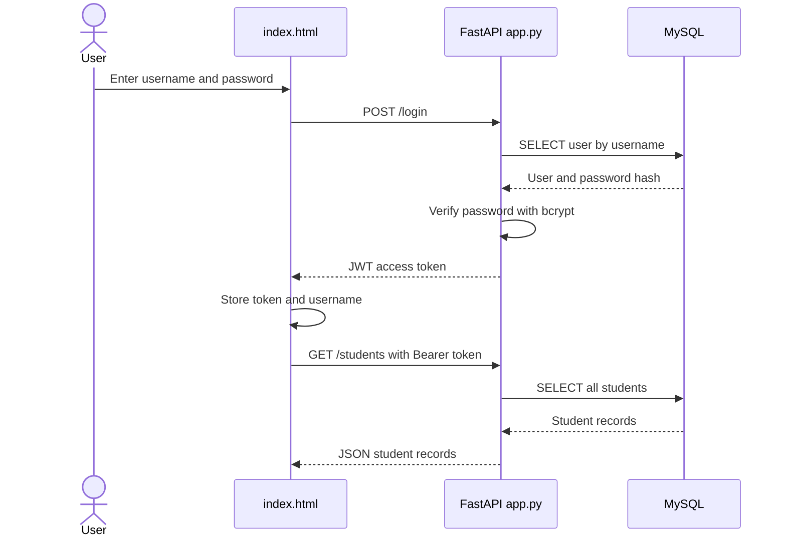

# Project Setup and Execution Guide

Follow the steps below to clone, configure, run, and test the project on your local machine.

## 1. Clone the GitHub Repository

Open VS Code terminal or Git Bash and execute:

```bash
git clone <YOUR_GITHUB_REPOSITORY_URL>
```

Navigate into the project directory:

```bash
cd <PROJECT_FOLDER_NAME>
```

## 2. Install Required Python Packages

Make sure Python is installed on your system.

Check Python version:

```bash
python --version
```

Install all the required dependencies using `requirements.txt`:

```bash
pip install -r requirements.txt
```

This will install all the Python packages required for the backend application.

## 3. Configure MySQL Credentials

Open `app.py` in VS Code.

Locate the MySQL database configuration and update the credentials according to your local MySQL setup.

Example:

```python
db_config = {
    "host": "localhost",
    "user": "root",
    "password": "root",
    "database": "dev"
}
```

Update the following details:

- **host:** localhost
- **user:** Your MySQL username
- **password:** Your MySQL password
- **database:** Your database name

Save the changes.

**Important:** Make sure your MySQL server is running.

## 4. Execute the SQL Script in MySQL Workbench

1. Open MySQL Workbench.
2. Connect to your local MySQL server.
3. Open the SQL script provided in the project.
4. Review the database and table creation queries.
5. Execute the complete SQL script by clicking the lightning icon.
6. Refresh the Schemas section.
7. Verify that the database and required tables are created successfully.

Make sure the database name in `app.py` matches the database created using the SQL script.

## 5. Install Live Server Extension in VS Code

We are using the frontend locally.

Follow these steps:

1. Open VS Code.
2. Navigate to Extensions.
3. Search for **Live Server**.
4. Install the Live Server extension.
5. Open the project folder in VS Code.

No frontend-backend IP address changes are required because we are running both applications locally.

The frontend is configured to communicate with the backend using:

```javascript
http://127.0.0.1:8000
```

## 6. Start the FastAPI Backend

Open a terminal in VS Code.

Make sure you are inside the project directory.

Start the backend application:


```bash
python app.py
```

Once the application starts successfully, the backend will be available at:

**Backend URL:**

```text
http://127.0.0.1:8000
```

**Swagger API Documentation:**

```text
http://127.0.0.1:8000/docs
```

Keep this terminal running.

## 7. Start the Frontend Using Live Server

1. Navigate to the frontend folder.
2. Locate `index.html`.
3. Right-click on `index.html`.
4. Select **Open with Live Server**.

## 8. Tech Stack

| Technology | Used in | Purpose |
|---|---|---|
| HTML5 | `index.html` | Defines the authentication form, student interface, navigation, and live socket page |
| CSS | `index.html` | Provides styling, layouts, responsiveness, animations, and dark/light component styles |
| JavaScript | `index.html` | Handles authentication, API calls, CRUD operations, UI updates, chat, and reconnection |
| Fetch API | `index.html` | Sends HTTP requests from the browser to the FastAPI backend |
| WebSocket API | `index.html` | Maintains a real-time bidirectional connection with FastAPI |
| JSON | `index.html` | Exchanges request and response data with the backend |
| `sessionStorage` | `index.html` | Stores the JWT and logged-in username in the browser session |
| FastAPI | `app.py` | Provides the REST API and WebSocket server |
| Python | `app.py` | Backend programming language |
| Pydantic | `app.py` | Defines request models and validates incoming data |
| JWT / `python-jose` | `app.py` | Creates and verifies authentication tokens |
| bcrypt | `app.py` | Securely hashes and verifies user passwords |
| MySQL | `app.py` | Stores users and student records |
| MySQL Connector/Python | `app.py` | Connects FastAPI to the MySQL database |
| CORS Middleware | `app.py` | Allows browser requests from the configured frontend origin |
| WebSocket | `app.py` | Handles real-time client-server messages |
| Uvicorn | `app.py` | Runs the FastAPI application server |

## Database Objects

The application uses the MySQL database `student_db`. The database structure shown in MySQL Workbench contains two tables:

```text
student_db
├── students
│   ├── id
│   ├── name
│   ├── age
│   └── course
└── users
    ├── id
    ├── username
    └── password
```

| Object | Type | Purpose | Used for |
|---|---|---|---|
| `student_db` | Database | Logical container for application data | Connecting the FastAPI backend to MySQL |
| `students` | Table | Stores student records | Student CRUD operations |
| `students.id` | Column | Unique identifier for a student | Finding, updating, and deleting a student |
| `students.name` | Column | Student's full name | Displaying and filtering student records |
| `students.age` | Column | Student's age | Displaying records and calculating average age |
| `students.course` | Column | Course assigned to a student | Filtering and course statistics |
| `users` | Table | Stores application login accounts | Signup and login |
| `users.id` | Column | Unique identifier for a user | Identifying a registered account |
| `users.username` | Column | Login name | Finding a user during login |
| `users.password` | Column | bcrypt password hash | Verifying a password without storing plaintext |

In addition to tables and columns, MySQL Workbench shows supporting database objects such as **indexes**, **foreign keys**, and **triggers**. These objects are not explicitly created or used by the current Python code, so they should not be assumed to participate in the application unless their definitions are checked in MySQL Workbench.

> The database connection in `app.py` is configured with database `student_db`, host `localhost`, and the `root` database user.

## **Developer Handbook**

This section explains how [index.html](./index.html) and [app.py](./app.py) work together. The browser is the **frontend**, while FastAPI is the **backend** and MySQL is the database.

```text
Browser (index.html)
        |
        | HTTP REST request or WebSocket message
        v
FastAPI server (app.py)
        |
        | MySQL SQL query
        v
MySQL database (student_db)
```

### 1. File responsibilities and technology context

#### `index.html`

[index.html](./index.html) is a self-contained browser application. It combines HTML for structure, CSS for presentation, and JavaScript for behavior.

| Part of the file | Technology | Responsibility |
|---|---|---|
| Page structure | HTML5 | Displays authentication, navigation, student table, modal, and chat sections |
| Visual design | CSS | Defines layout, colors, responsive behavior, badges, tables, and notifications |
| Browser logic | JavaScript | Controls authentication mode, CRUD actions, filtering, sorting, and logout |
| API communication | Fetch API | Sends JSON requests to FastAPI and reads JSON responses |
| Session state | `sessionStorage` | Keeps the JWT and username after login while the browser tab/session remains active |
| Real-time communication | WebSocket API | Opens `ws://127.0.0.1:8000/ws`, sends chat messages, and handles reconnection |

The file uses no frontend framework or separate JavaScript build process. The browser loads it directly and executes the script near the bottom of the HTML document.

#### `app.py`

[app.py](./app.py) is the backend server. It exposes REST routes and a WebSocket route and communicates with MySQL.

| Part of the file | Technology | Responsibility |
|---|---|---|
| Server framework | FastAPI | Creates REST endpoints and the WebSocket endpoint |
| Application language | Python | Defines models, functions, validation, and database operations |
| Request validation | Pydantic | Validates signup, login, student, and partial-update request bodies |
| Password security | bcrypt | Hashes passwords and safely verifies login passwords |
| Authentication | JWT / `python-jose` | Creates signed tokens and validates protected API requests |
| Database access | MySQL Connector/Python | Opens connections and executes parameterized SQL |
| Database | MySQL | Stores user accounts and student records |
| Browser security | CORS Middleware | Allows requests from the configured Live Server origin |
| ASGI server | Uvicorn | Runs FastAPI on port `8000` |

The backend and frontend communicate using HTTP for authentication and CRUD operations. WebSocket communication is used separately for the live-chat demonstration.

### 2. Application startup

#### Frontend startup

1. Open [index.html](./index.html) with Live Server.
2. The HTML creates the login/signup view and the hidden student-management view.
3. The JavaScript section initializes:
   - `API`: `http://localhost:8000`
   - `WS_URL`: `ws://127.0.0.1:8000/ws`
   - `token`: JWT read from `sessionStorage`
   - `currentUser`: username read from `sessionStorage`
   - `students`: list of student records
   - `authMode`: currently `login` or `signup`
4. `setAuthMode("login")` prepares the page for login.
5. If a token and username exist in `sessionStorage`, `enterApp()` is called and the saved session is restored.

#### Backend startup

1. Run `app.py` with Uvicorn.
2. FastAPI creates the application instance and enables CORS for `http://127.0.0.1:5500`.
3. Pydantic request models validate incoming JSON.
4. `get_db()` creates a MySQL connection whenever an endpoint needs one.
5. The REST endpoints and `/ws` WebSocket endpoint become available.

The CORS middleware allows requests only from the configured Live Server origin. If the frontend runs from another origin, it must be added to `allow_origins`.

### 3. Login and signup flow

The authentication form is defined in [index.html](./index.html). It always calls `submitAuth(event)` when submitted.

#### Signup

1. The user selects **Create an account**.
2. `setAuthMode("signup")` shows the confirm-password field and changes the button text.
3. `submitAuth()` reads the username and password.
4. It stops if the password and confirm-password values do not match.
5. It sends:

   ```http
   POST http://localhost:8000/signup
   Content-Type: application/json

   {
     "username": "student1",
     "password": "1234"
   }
   ```

6. FastAPI validates the data using the `User` Pydantic model.
7. The username validator rejects usernames containing only digits.
8. `bcrypt.hashpw()` creates a salted hash instead of storing the password directly.
9. The backend inserts the username and hashed password into the MySQL `users` table.
10. A duplicate username raises HTTP `409`.
11. On success, the frontend shows a toast and switches back to login mode.

#### Login

1. The user enters a username and password and selects **Sign in**.
2. The frontend sends:

   ```http
   POST http://localhost:8000/login
   Content-Type: application/json

   {
     "username": "student1",
     "password": "1234"
   }
   ```

3. FastAPI searches MySQL for the username.
4. If no user is found, it returns HTTP `401`.
5. `bcrypt.checkpw()` compares the submitted password with the stored password hash.
6. If the password is incorrect, it also returns HTTP `401`.
7. On success, FastAPI creates a JWT containing:
   - `sub`: the username
   - `exp`: an expiration time 30 minutes after creation
8. The frontend stores the token and username in `sessionStorage`.
9. `enterApp()` hides the authentication view and opens the student-management view.
10. The frontend calls `getStudents()` and `connectWS()`.



### 4. JWT-protected API requests

After login, `api()` acts as the shared HTTP request helper.

For every request:

1. A JSON `Content-Type` header is set.
2. The JWT is added as:

   ```http
   Authorization: Bearer <access_token>
   ```

3. `fetch()` sends the request to `http://localhost:8000`.
4. The response body is parsed as JSON.
5. HTTP `401` clears the session and logs out the user.
6. Other unsuccessful responses display their error message in a toast.

FastAPI receives the header through `verify_token()`. It checks:

- The authorization scheme is `Bearer`.
- The JWT signature is valid.
- The JWT has not expired.
- The token contains a username in the `sub` field.

If any check fails, the request receives HTTP `401`.

### 5. Student list flow

After successful login, `enterApp()` calls `getStudents()`.

1. `getStudents()` sets `loading = true` and temporarily renders skeleton rows.
2. It sends `GET /students`.
3. `verify_token()` protects the endpoint.
4. FastAPI runs:

   ```sql
   SELECT * FROM students;
   ```

5. MySQL returns all student records.
6. FastAPI converts the rows to JSON.
7. The frontend stores the records in `students`.
8. `render()` displays table rows, calculates statistics, and applies filtering and sorting.

The user can search by ID:

1. Enter an ID in the search box and press Enter or select **Find by ID**.
2. `searchStudent()` sends `GET /students/{id}`.
3. FastAPI runs:

   ```sql
   SELECT * FROM students WHERE id=%s;
   ```

4. The result is returned as one record or HTTP `404`.

### 6. Student CRUD operations

The modal system in [index.html](./index.html) provides the form for create and update operations.

| Operation | Frontend action | HTTP request | FastAPI behavior |
|---|---|---|---|
| Create | `openAdd()` | `POST /students` | Inserts name, age, and course |
| Read all | `getStudents()` | `GET /students` | Returns all students |
| Read one | `searchStudent()` | `GET /students/{id}` | Returns the matching student |
| Replace | `openEdit()` | `PUT /students/{id}` | Replaces name, age, and course |
| Partial update | `openCourse()` | `PATCH /students/{id}` | Updates only the course field |
| Delete | `openDelete()` | `DELETE /students/{id}` | Deletes the matching student |

After create, update, or delete operations:

1. `submitModal()` disables the submit button.
2. It calls the operation-specific function.
3. On success, it closes the modal.
4. It calls `getStudents()` again to reload and refresh the table.
5. A success toast confirms the operation.

#### Create request

```json
{
  "name": "Biplov",
  "age": 25,
  "course": "FDE-DB"
}
```

The body is sent to `POST /students`.

#### PUT versus PATCH

- `PUT /students/{id}` replaces all three fields: name, age, and course.
- `PATCH /students/{id}` updates only fields included in the JSON body.
- The frontend uses `PATCH` when the user changes only a student's course.

### 7. Frontend rendering and filtering

The `render()` function is responsible for converting JavaScript data into HTML.

- `sortBy()` changes the sort field or reverses the sort direction.
- `render()` filters by name or course using the filter box.
- The table is rebuilt safely, escaping user values through `esc()`.
- Student statistics are calculated from the full `students` array:
  - total student count
  - number of unique courses
  - average age
  - most common course
- The course badge color is deterministically generated from the course name.

The loading state displays skeleton table rows until `getStudents()` finishes.

### 8. WebSocket flow

The WebSocket is separate from the REST API. It is used only for live chat in the current implementation.

1. After login, `enterApp()` calls `connectWS()`.
2. `connectWS()` creates:

   ```javascript
   new WebSocket("ws://127.0.0.1:8000/ws")
   ```

3. FastAPI accepts the connection in `@app.websocket("/ws")`.
4. The `onopen` event marks the status as **Online**.
5. The user sends a message with `socket.send(msg)`.
6. FastAPI receives the text with `await websocket.receive_text()`.
7. FastAPI sends back:

   ```text
   Server received: <message>
   ```

8. `ws.onmessage` adds the response to the chat display.

If the connection closes unexpectedly:

- The status becomes **Offline**.
- The frontend waits 3 seconds.
- `connectWS()` attempts to reconnect.
- A manual disconnect prevents automatic reconnection.

At present, the WebSocket does not use the JWT or broadcast CRUD changes to other users. Student additions and updates still happen through HTTP REST endpoints.

### 9. Logout flow

The logout button calls `logout()`.

1. Token and username variables are cleared.
2. `sessionStorage.clear()` removes saved authentication data.
3. The WebSocket is closed.
4. The student application view is hidden.
5. The authentication view is displayed again.
6. The password field is cleared.
7. Authentication mode is reset to login.
